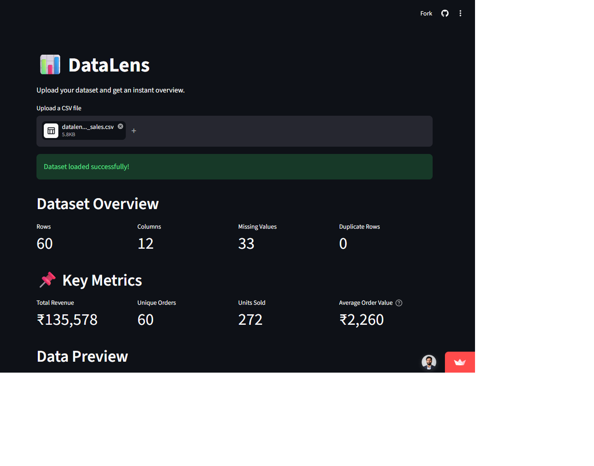
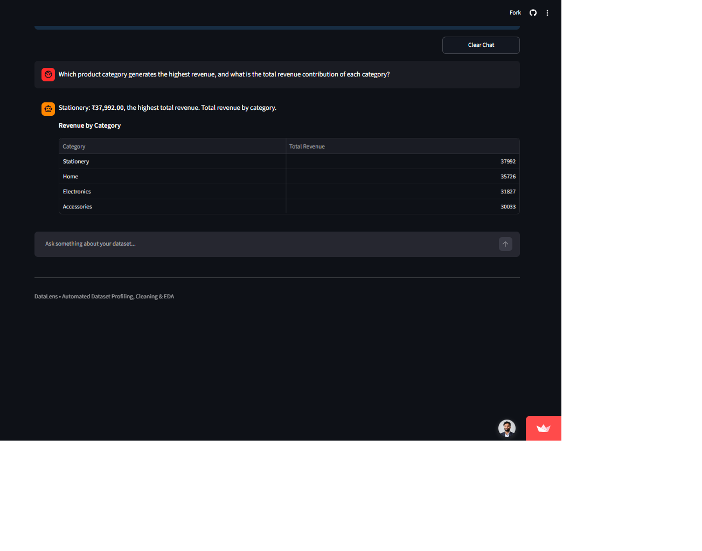

# DataLens

**Turn sales CSVs into clear metrics, useful breakdowns, and natural-language answers.**

DataLens is a Streamlit app for exploring and cleaning CSV datasets. It combines dataset profiling and sales analytics with an assistant that answers supported revenue questions directly and uses Gemini for questions that need a broader explanation.

**[Open the live demo](https://datalens-b8ptmnzbhk2s8f2nii32d8.streamlit.app/)**

## Screenshots

### Sales dashboard

### Revenue question and breakdown

## Features

- Upload and preview CSV files, with row, column, missing-value, and duplicate summaries
- Clean missing values and duplicate rows, then export the cleaned dataset
- Explore revenue by category and city, price distributions, and revenue trends
- Ask natural-language questions about sales and dataset contents
- Get automatic business insights and key sales metrics

## Technology Stack

- Python and Streamlit
- Pandas and NumPy
- Google Gemini API for unsupported questions

## Installation

1. Clone the repository.
2. Install the dependencies:

   `python -m pip install -r requirements.txt`

3. Create a `.env` file in the project root:

   `GEMINI_API_KEY=your_api_key_here`

4. Start the application:

   `streamlit run app.py`

## Security

Never commit your `.env` file or expose your Gemini API key.

For unsupported questions, DataLens sends your question and a dataset summary to Gemini. The summary contains column names and types, row, duplicate, missing, and unique-value counts, and numeric aggregates only for columns with at least five non-missing values. Raw rows and categorical values are not sent.

Do not upload confidential or sensitive datasets to the AI assistant without an appropriate data privacy policy.

## Project Status

DataLens v1.0 is live on Streamlit Community Cloud as a portfolio project. Feedback and bug reports are welcome through GitHub.

## Author

[Manu Pawar](https://github.com/mmanupawar6388)
